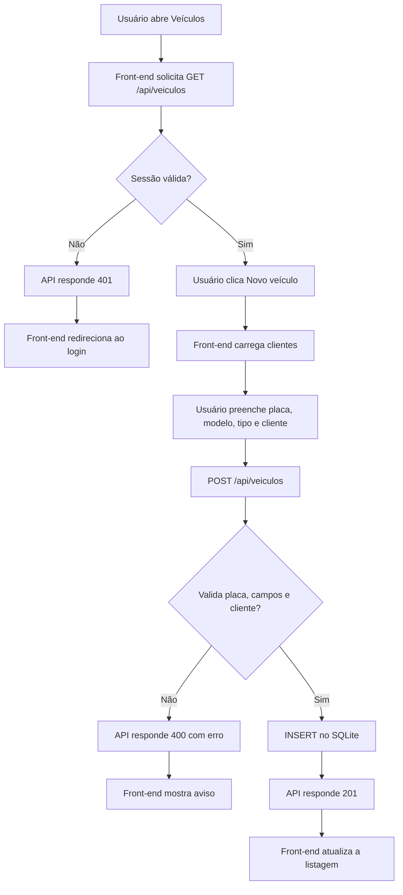

# Oficina AutoCerta — Engenharia reversa

## Visão geral
Sistema web de oficina mecânica com front-end HTML/CSS/JavaScript, API Node.js/Express e banco SQLite. A autenticação é baseada em sessão (`express-session`); as senhas são verificadas com bcrypt e o CPF é cifrado com AES-256-GCM.

## Como executar
Requisito: Node.js 22.13 ou superior.
```bash
cd sistema_comentado
npm install
npm start
```
Acesse http://localhost:3000. Credenciais de demonstração estão no `LEIA-ME.txt` fornecido. Não reutilize essas credenciais em produção.

## 1. Requisitos funcionais
- RF01 — Autenticar usuário com login e senha.
- RF02 — Encerrar sessão e voltar ao login.
- RF03 — Consultar o usuário autenticado (`/api/me`).
- RF04 — Listar e buscar clientes por nome, CPF, telefone ou e-mail.
- RF05 — Cadastrar clientes com nome e CPF obrigatórios, e-mail opcional validado.
- RF06 — Editar dados de cliente existente.
- RF07 — Impedir CPF duplicado após descriptografar os CPFs armazenados.
- RF08 — Listar veículos com dados do cliente associado.
- RF09 — Cadastrar veículo com placa, modelo, tipo e cliente existente.
- RF10 — Impedir placa duplicada e validar o padrão de placa.
- RF11 — Listar agendamentos com dados do veículo e cliente.
- RF12 — Cadastrar agendamento com veículo existente, data válida e serviço.
- RF13 — Alterar a data de um agendamento existente.
- RF14 — Exibir mensagens de erro/sucesso no front-end e redirecionar para login quando a sessão expira.

## Regras de negócio
- Todas as rotas de dados (`/api/me`, clientes, veículos e agendamentos) exigem sessão autenticada; `/api/login` e `/api/logout` não exigem sessão.
- Sessão configurada para 30 minutos e cookie `httpOnly`.
- Nome e CPF são obrigatórios no cliente; CPF deve conter 11 dígitos após remover pontuação; e-mail, se informado, deve ter formato básico válido.
- CPF deve ser único; como é cifrado com IV aleatório, o código percorre e descriptografa os CPFs para comparar.
- Placa é normalizada removendo espaços/hífens e convertendo para maiúsculas; regex aceita padrão antigo/Mercosul.
- Veículo deve referenciar cliente existente; agendamento deve referenciar veículo existente.
- Data de agendamento precisa estar em `AAAA-MM-DD` e corresponder a uma data real.
- Serviço é obrigatório. Não há regra que impeça dois agendamentos para o mesmo dia/veículo.
- O sistema não implementa exclusão de clientes, veículos ou agendamentos; também não há controle de permissões por perfil apesar dos nomes dos usuários.

## 2. DER
Entidades:
- `usuarios(id PK, nome, login UNIQUE, senha)`
- `clientes(id PK, nome, cpf, telefone, email)`
- `veiculos(id PK, placa UNIQUE, modelo, tipo, marca, cliente_id FK)`
- `agendamentos(id PK, veiculo_id FK, data_agendamento, servico)`

Relacionamentos: um cliente pode possuir vários veículos (1:N); um veículo pode ter vários agendamentos (1:N). Os usuários não têm relacionamento com clientes, veículos ou agendamentos.

## 3. Mapa da API
| Método e rota | Autenticação | Entrada | Saída/validações |
|---|---|---|---|
| POST `/api/login` | Não | JSON `{login, senha}` | 200 `{ok:true}`; 400 se campos ausentes; 401 se credenciais inválidas. |
| POST `/api/logout` | Não | Nenhuma | Destrói sessão e retorna `{ok:true}`. |
| GET `/api/me` | Sim | Cookie de sessão | 200 `{id,nome}`; 401 sem sessão. |
| GET `/api/clientes?busca=` | Sim | Query `busca` opcional | Array de clientes com CPF descriptografado; filtra nome/e-mail/telefone/CPF. |
| POST `/api/clientes` | Sim | `nome, cpf, telefone?, email?` | 201 `{ok:true}`; 400 por nome/CPF/e-mail inválido ou CPF duplicado. |
| PUT `/api/clientes/:id` | Sim | ID na URL + dados de cliente | 200 `{ok:true}`; 404 se não existe; 400 se validação falhar. |
| GET `/api/veiculos` | Sim | Nenhuma | Array com veículo e `cliente_nome`; ordena por modelo. |
| POST `/api/veiculos` | Sim | `placa, modelo, tipo, marca?, cliente_id` | 201; 400 por placa inválida/duplicada, modelo/tipo ausente ou cliente inexistente. |
| GET `/api/agendamentos` | Sim | Nenhuma | Array com data, serviço, veículo e dados do cliente; ordena por mês/data. |
| POST `/api/agendamentos` | Sim | `veiculo_id, data_agendamento, servico` | 201; 400 se veículo não existe, data inválida ou serviço ausente. |
| PUT `/api/agendamentos/:id` | Sim | ID na URL + `data_agendamento` | 200; 404 se não existe; 400 se data inválida. |

Observações: erros de validação usam JSON `{erro: "mensagem"}`. As consultas SQL usam parâmetros preparados em operações com dados do usuário. Não há rota para excluir registros nem para editar veículos.

## 4. Mapa do front-end
| Página | Script(s) | Rotas chamadas | Funções |
|---|---|---|---|
| `login.html` | `js/comum.js`, `js/login.js` | POST `/api/login` | Autenticação e exibição de erro. |
| `principal.html` | `js/comum.js` + `iniciarPagina()` inline | GET `/api/me`, POST `/api/logout` | Menu e sessão. |
| `clientes.html` | `js/comum.js`, `js/clientes.js` | GET `/api/me`, GET `/api/clientes?busca=`, POST `/api/clientes`, PUT `/api/clientes/:id`, POST `/api/logout` | Busca, listagem, cadastro e edição. |
| `veiculos.html` | `js/comum.js`, `js/veiculos.js` | GET `/api/me`, GET `/api/veiculos`, GET `/api/clientes`, POST `/api/veiculos`, POST `/api/logout` | Listagem e cadastro. |
| `agendamentos.html` | `js/comum.js`, `js/agendamentos.js` | GET `/api/me`, GET `/api/agendamentos`, GET `/api/veiculos`, POST `/api/agendamentos`, PUT `/api/agendamentos/:id`, POST `/api/logout` | Listagem, cadastro e alteração da data. |

`comum.js` centraliza `api()`, tratamento de sessão 401, escape de HTML (`esc()`), formatação e mensagens de aviso.

## 5. Análise de segurança
### Pontos positivos observados
- Senhas armazenadas como hashes bcrypt e comparadas por `bcrypt.compareSync`.
- CPF cifrado com AES-256-GCM e IV aleatório; a tag de autenticação detecta alterações.
- Cookie de sessão tem `httpOnly: true`.
- Rotas de dados usam middleware `exigirLogin`.
- Consultas parametrizadas e escape de textos antes de inserir conteúdo em `innerHTML`.

### Riscos
- Chave AES derivada de segredo e salt fixos no código (`seguranca.js`): quem obtiver o código pode derivar a chave e descriptografar os CPFs.
- `secret` da sessão está fixo no código e o armazenamento padrão de sessão não é apropriado para produção.
- Cookie não configura `sameSite` nem `secure`; não há limitação de tentativas de login nem proteção explícita contra CSRF.
- Validação de CPF verifica apenas quantidade de dígitos, não os dígitos verificadores.
- `/api/logout` não exige login, embora destrua a sessão presente; não é crítico, mas pode ser protegido por consistência.
- A busca de clientes descriptografa todos os CPFs em memória; pode ficar lenta com muitos registros.
- CPF é devolvido em texto claro à interface após autenticação; deve-se limitar quem pode consultá-lo.

### Três melhorias prioritárias
1. Mover `SESSION_SECRET` e `CPF_ENCRYPTION_KEY` para variáveis de ambiente/secret manager, rotacionar segredos e não versioná-los.
2. Configurar cookie `sameSite: 'lax'` (ou política adequada), `secure: true` em HTTPS, armazenamento persistente de sessões e proteção CSRF para operações que alteram dados.
3. Implementar rate limiting e atraso progressivo no login, validar dígitos verificadores do CPF e adicionar testes automatizados de API; avaliar mascarar CPF na listagem.

## 6. Casos de teste e resultados
Os resultados abaixo são verificações reais do arquivo SQLite fornecido e inspeções estáticas do código. **Não são testes HTTP ponta a ponta**, pois o servidor não iniciou no ambiente de análise devido à ausência do pacote `express`; veja `docs/evidencias/limite_execucao.md`.

| ID | Caso | Método real | Resultado observado |
| CT01 | Existência das quatro tabelas | Consulta SQLite sqlite_master | PASSOU: usuarios, sqlite_sequence, clientes, veiculos, agendamentos |
| CT02 | Quantidade inicial em usuarios | SELECT COUNT(*) | PASSOU: 3 registros (esperado 3) |
| CT03 | Quantidade inicial em clientes | SELECT COUNT(*) | PASSOU: 3 registros (esperado 3) |
| CT04 | Quantidade inicial em veiculos | SELECT COUNT(*) | PASSOU: 4 registros (esperado 4) |
| CT05 | Quantidade inicial em agendamentos | SELECT COUNT(*) | PASSOU: 4 registros (esperado 4) |
| CT06 | FK veículos -> clientes | PRAGMA foreign_key_list(veiculos) | PASSOU: [(0, 0, 'clientes', 'cliente_id', 'id', 'NO ACTION', 'NO ACTION', 'NONE')] |
| CT07 | FK agendamentos -> veículos | PRAGMA foreign_key_list(agendamentos) | PASSOU: [(0, 0, 'veiculos', 'veiculo_id', 'id', 'NO ACTION', 'NO ACTION', 'NONE')] |
| CT08 | Unicidade da placa declarada no esquema | Inspeção de oficina_db.sql | PASSOU: UNIQUE declarado na coluna placa |
| CT09 | Hash bcrypt usado no login | Inspeção de server.js | PASSOU: Comparação com bcrypt.compareSync |
| CT10 | Sessão expira em 30 minutos | Inspeção de server.js | PASSOU: maxAge configurado para 30 minutos |
| CT11 | Rotas de dados usam middleware de login | Inspeção de server.js | PASSOU: Rotas consultadas incluem exigirLogin |
| CT12 | CPF usa AES-256-GCM | Inspeção de seguranca.js | PASSOU: Algoritmo AES-256-GCM declarado |
| CT13 | Escape de HTML no front-end | Inspeção de comum.js | PASSOU: Função esc() codifica caracteres HTML |
| CT14 | Placa é normalizada para maiúsculas | Inspeção de server.js | PASSOU: Normalização e regex presentes |
| CT15 | Validação rejeita data impossível | Inspeção de server.js | PASSOU: Validação compara data ISO de retorno |
| CT16 | Agendamentos incluem JOIN com veículos e clientes | Inspeção de server.js | PASSOU: Consulta possui os dois JOINs |
| CT17 | Busca de clientes contempla nome/e-mail/telefone/CPF | Inspeção de server.js | PASSOU: Quatro campos contemplados no filtro |

### Casos funcionais que devem ser executados após instalar as dependências
Estes casos são recomendados para completar o teste integrado local e não foram marcados como executados:
- Login correto deve retornar 200 e criar cookie de sessão.
- Login incorreto deve retornar 401.
- GET `/api/clientes` sem sessão deve retornar 401.
- Cadastro de cliente com CPF de 10 dígitos deve retornar 400.
- Cadastro com e-mail malformado deve retornar 400.
- CPF duplicado deve retornar 400.
- Placa inválida ou duplicada deve retornar 400.
- Veículo com cliente inexistente deve retornar 400.
- Data `2026-02-31` deve retornar 400.
- Agendamento com veículo inexistente deve retornar 400.
- PUT para id inexistente deve retornar 404.
- Logout deve invalidar a sessão; acesso seguinte a `/api/me` deve retornar 401.

## 7. Diagrama de fluxo — cadastrar veículo


## 8. Código comentado
A pasta `sistema_comentado/` contém uma cópia dos arquivos da aplicação com comentários explicando a intenção das partes principais: autenticação, validações, cifragem do CPF, consultas com JOIN, tratamento de sessão e escape contra XSS. Os comentários não substituem a execução dos testes integrados.

## Limites e próximos passos
- Executar `npm install` e `npm start` no computador de desenvolvimento.
- Capturar evidências reais (prints da tela, Network e respostas HTTP) em `docs/evidencias/`.
- Rodar os casos de API recomendados e atualizar os resultados conforme o comportamento observado.
- Gerar os commits em pelo menos três dias diferentes, como pede a atividade. Não falsifique datas de commits; faça pequenas entregas reais ao longo dos dias.
